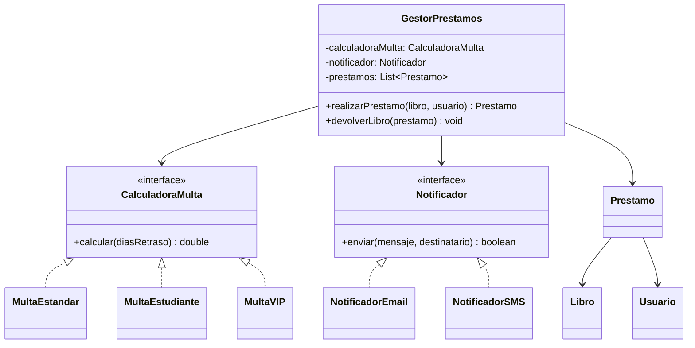

# 🏛️ Sistema de Biblioteca - Principios SOLID

[](https://www.oracle.com/java/)
[](LICENSE)
[](https://tecsup.edu.pe/)

> Implementación práctica de los 5 principios SOLID utilizando un sistema de biblioteca como ejemplo didáctico.

## 📋 Tabla de Contenidos

- [Descripción](#-descripción)
- [Principios SOLID Implementados](#-principios-solid-implementados)
- [Estructura del Proyecto](#-estructura-del-proyecto)
- [Requisitos](#-requisitos)
- [Instalación y Ejecución](#-instalación-y-ejecución)
- [Ejemplos de Uso](#-ejemplos-de-uso)
- [Arquitectura](#-arquitectura)

## 🎯 Descripción

Este proyecto es una implementación educativa que demuestra cómo aplicar los **5 principios SOLID** en el desarrollo de software usando Java. A través de un sistema de biblioteca simulado, se muestran las mejores prácticas de diseño orientado a objetos.

Los principios SOLID son fundamentales para escribir código:
- ✅ **Mantenible**
- ✅ **Escalable**
- ✅ **Testeable**
- ✅ **Flexible**
- ✅ **Reutilizable**

## 🧩 Principios SOLID Implementados

### 1. **S**ingle Responsibility Principle (SRP)
> *Una clase debe tener una sola razón para cambiar*

```java
class Libro {
    // Solo maneja información del libro
}

class Usuario {
    // Solo maneja información del usuario
}

class Prestamo {
    // Solo maneja información del préstamo
}
```

### 2. **O**pen/Closed Principle (OCP)
> *Abierto para extensión, cerrado para modificación*

```java
interface CalculadoraMulta {
    double calcular(long diasRetraso);
}

class MultaEstandar implements CalculadoraMulta { ... }
class MultaEstudiante implements CalculadoraMulta { ... }
class MultaVIP implements CalculadoraMulta { ... }
```

### 3. **L**iskov Substitution Principle (LSP)
> *Los objetos derivados deben poder sustituir a la clase base*

```java
Notificador notificador = new NotificadorEmail();
// O también:
Notificador notificador = new NotificadorSMS();
// Ambos funcionan de manera intercambiable
```

### 4. **I**nterface Segregation Principle (ISP)
> *Los clientes no deben depender de interfaces que no usan*

```java
interface Reservable { boolean reservar(Usuario usuario); }
interface Prestable { boolean prestar(Usuario usuario); }
interface Renovable { boolean renovar(Prestamo prestamo); }
```

### 5. **D**ependency Inversion Principle (DIP)
> *Depender de abstracciones, no de implementaciones concretas*

```java
class GestorPrestamos {
    private CalculadoraMulta calculadoraMulta;  // ← Abstracción
    private Notificador notificador;            // ← Abstracción
    
    public GestorPrestamos(CalculadoraMulta calc, Notificador notif) {
        // Inyección de dependencias
    }
}
```

## 📁 Estructura del Proyecto

```
solid-tecsup/
├── src/
│   └── SistemaBiblioteca.java    # Código principal
├── docs/
│   ├── diagrams/                 # Diagramas UML
│   └── examples/                 # Ejemplos adicionales
├── tests/                        # Tests unitarios (próximamente)
├── README.md                     # Este archivo
└── LICENSE                       # Licencia MIT
```

## 💻 Requisitos

- **Java 11+** (recomendado Java 17)
- **IDE:** IntelliJ IDEA, Eclipse, VS Code, o cualquier editor de texto
- **Terminal/Consola** para ejecutar comandos

## 🚀 Instalación y Ejecución

### 1. Clonar el repositorio

```bash
git clone https://github.com/rafotijero/solid-tecsup.git
cd solid-tecsup
```

### 2. Compilar el código

```bash
# Desde la raíz del proyecto
javac src/SistemaBiblioteca.java
```

### 3. Ejecutar el programa

```bash
# Ejecutar desde el directorio src/
cd src
java SistemaBiblioteca
```

### 4. Salida esperada

```
🏛️  SISTEMA DE BIBLIOTECA - PRINCIPIOS SOLID
==================================================

📋 GESTOR PARA USUARIOS REGULARES:

📋 GESTOR PARA ESTUDIANTES:

🔄 REALIZANDO PRÉSTAMOS:
📧 Email a Ana García: Has prestado '1984'. Fecha de devolución: 2025-09-21
✅ Préstamo realizado: '1984' para Ana García
📱 SMS a Carlos López: Has prestado 'Cien años de soledad'. Fecha de devolución: 2025-09-21
✅ Préstamo realizado: 'Cien años de soledad' para Carlos López

📅 SIMULANDO DEVOLUCIÓN TARDÍA:
⚠️  Retraso de 3 días. Multa: $30.0
📚 '1984' devuelto por Ana García

📅 DEVOLUCIÓN A TIEMPO:
✅ Libro devuelto a tiempo
📚 'Cien años de soledad' devuelto por Carlos López
```

## 📖 Ejemplos de Uso

### Crear diferentes tipos de gestores

```java
// Gestor para usuarios regulares
GestorPrestamos gestorRegular = new GestorPrestamos(
    new MultaEstandar(),      // $10 por día de retraso
    new NotificadorEmail()    // Notificación por email
);

// Gestor para estudiantes
GestorPrestamos gestorEstudiante = new GestorPrestamos(
    new MultaEstudiante(),    // $5 por día de retraso
    new NotificadorSMS()      // Notificación por SMS
);

// Gestor para usuarios VIP
GestorPrestamos gestorVIP = new GestorPrestamos(
    new MultaVIP(),           // Sin multa
    new NotificadorEmail()    // Notificación por email
);
```

### Extensibilidad del sistema

Agregar nuevos tipos de multa es sencillo:

```java
class MultaPremium implements CalculadoraMulta {
    @Override
    public double calcular(long diasRetraso) {
        // Multa progresiva: $15 primer día, +$5 cada día adicional
        return diasRetraso > 0 ? 15 + ((diasRetraso - 1) * 5) : 0;
    }
}
```

## 🏗️ Arquitectura



### Conceptos clave demostrados:

- ✅ Responsabilidad única de clases
- ✅ Extensibilidad sin modificación
- ✅ Principio de sustitución
- ✅ Segregación de interfaces
- ✅ Inversión de dependencias
- ✅ Inyección de dependencias
- ✅ Polimorfismo
- ✅ Abstracción

---

## 👨‍💻 Autor

**Rafael Tijero**
- GitHub: [@rafotijero](https://github.com/rafotijero)
- Institución: [TECSUP](https://tecsup.edu.pe/)

---

*Desarrollado con ❤️ para la comunidad educativa de TECSUP*